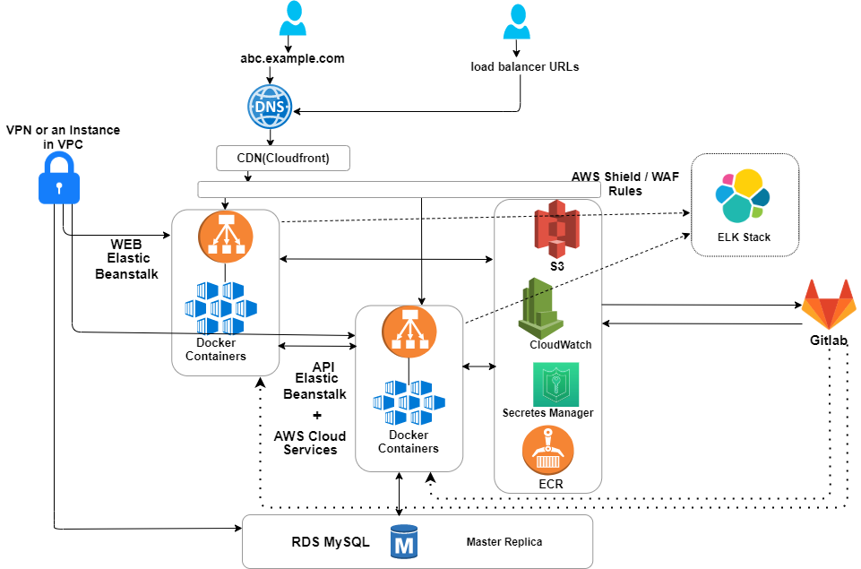
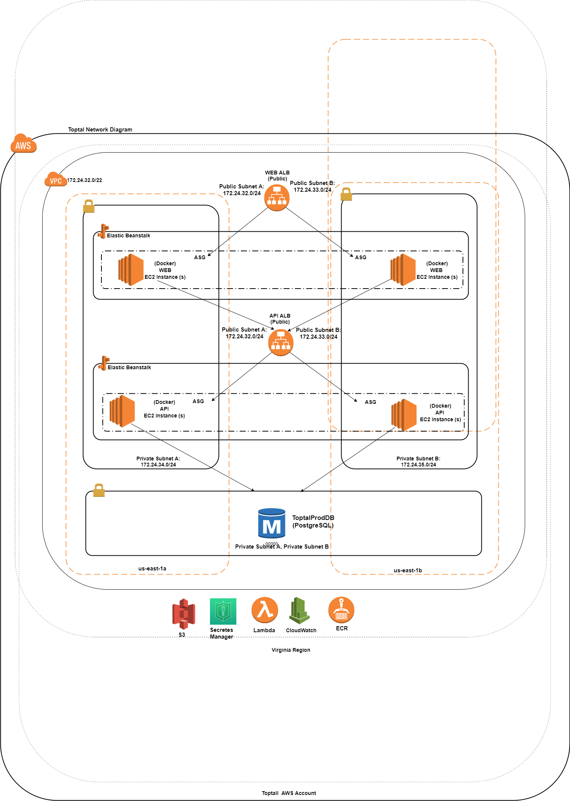
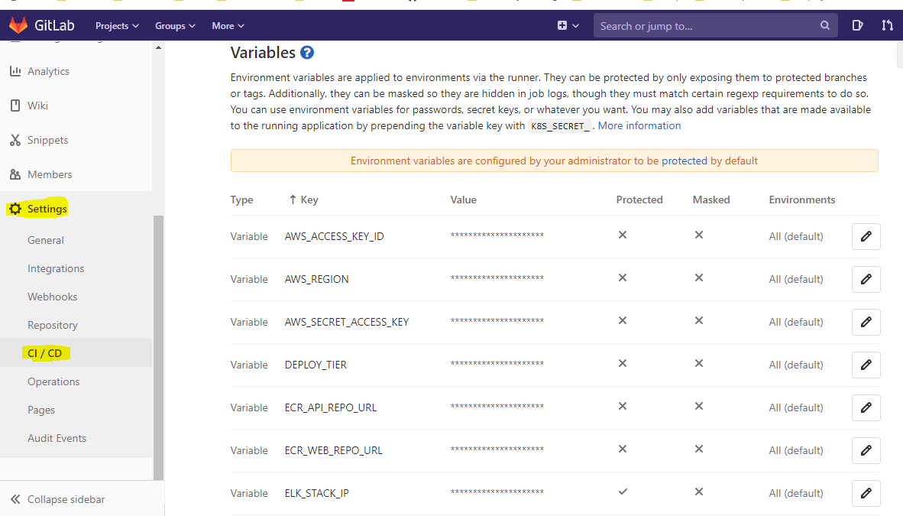

# Toptal Screening - Sample 3-tier app

This project is to present a solution for automating infrastructure provisioning and deployment of multi-tier application ensuring that it is performance optimized, highly secure, highly available, and highly scalable and will handle any kind of server failures (hardware/software) and components are updated without any downtime and notify us any kind of scaling activities happening due to heavy/less traffic on the both of web and api applications. 


## Architecture diagram:




## Network diagram:



## Configuration steps

In this application, we are using AWS Cloudformation, Bash Script, AWSCLI tools for building infrastructure (Infrastructure-as-Code) and Gitlab, AWSEBCLI as CI/CD, Version control tool.

We also use AWS Elasticbeanstalk service with deployment policy of rolling with additional batch and sticky session enabled so that the application will not encounter any downtime. 

So, here are the prerequisites for infrastructure creation and provisioning of aws resources:
- AWS account
- GitLab account
- awscli, awsebcli tools


After finishing <a href="checklist.md">checklist of items</a>, run the command on your local machine and hit enter
```
aws configure --profile ToptalAdmin
```
and then enter the following details:
```
AWS Access Key ID [None]:         <enter access key provided in shared file and hit enter>
AWS Secret Access Key [None]:      <enter secret key provided in shared file and hit enter>
Default region name [None]:        us-east-1
Default output format [None]:      <just hit enter>

```

For every aws command you run, make sure you add the option ```--profile ToptalAdmin``` so that the cli will consider those keys.

Ensure that there is no S3 bucket named 'toptal-website-virginia' in virginia region. If that bucket is being used by other projects, launch the stack with different S3 bucket name by configuring `S3BucketName` variable in <a href="cloudformation/vars.sh">cloudformation/vars.sh</a> file.

```
aws s3 rm s3://toptal-website-virginia/ --recursive  --profile ToptalAdmin --region us-east-1
```

Ensure that there are no Elastic Beanstalk environments running on application 'Toptal-PROD-Api-App' or 'Toptal-PROD-Api-Web' in virginia region.

```
aws elasticbeanstalk terminate-environment --environment-name Toptal-PROD-ApiServer --profile ToptalAdmin --region us-east-1
aws elasticbeanstalk terminate-environment --environment-name Toptal-PROD-WebServer --profile ToptalAdmin --region us-east-1
```

> Note: When you are redepoying stacks, run below commands to delete secrets:
```
aws secretsmanager delete-secret --secret-id PROD/Toptal/ApiEB --force-delete-without-recovery  --profile ToptalAdmin 

aws secretsmanager delete-secret --secret-id PROD/Toptal/WebEB --force-delete-without-recovery --profile ToptalAdmin

aws secretsmanager delete-secret --secret-id PROD/Toptal/DBCred --force-delete-without-recovery --profile ToptalAdmin

aws rds delete-db-instance --db-instance-identifier toptal-prod-dbinstance --region us-east-1 --profile ToptalAdmin
```

Create 2 ECR repos for hosting Api and Web docker container images by running below commands:
 ```
aws ecr create-repository --repository-name toptal-api --profile ToptalAdmin
aws ecr create-repository --repository-name toptal-web --profile ToptalAdmin
 ```

Infrastructure setup in Virginia region will be launched from local machine by running below commands:  
```
git clone https://git.toptal.com/screening/pradeep-kumar-vijayagiri.git toptal-prod
cd toptal-prod/cloudformation/
bash init.sh
```

When you run above commands, CloudFormation stacks will be created at https://console.aws.amazon.com/cloudformation/home?region=us-east-1 and the required secrets for api and web will be created at https://console.aws.amazon.com/secretsmanager/home?region=us-east-1

Once all the stacks are created, you can connect to the instances in private subnet through <a href="https://medium.com/@korniichuk/session-manager-e724eb105eb7">Session Manager</a>

## Gitlab variables setup for CI/CD (api & web)

Both web and api applicaions are deployed using Gitlab CICD pipeline and we need to configure below variables before deploying our code:

 ```
AWS_ACCESS_KEY_ID        xxxxxxxxxxxx
AWS_SECRET_ACCESS_KEY    xxxxxxxx
AWS_BASE_REGION          us-east-1
DEPLOY_TIER              allowed valuse are: Web / Api / Both
ECR_API_REPO_URL         <aws_account_id>.dkr.ecr.us-east-1.amazonaws.com/toptal-api
ECR_WEB_REPO_URL         <aws_account_id>.dkr.ecr.us-east-1.amazonaws.com/toptal-web
```


For scaling instances in API/Web tiers, set the autoscaling min and max count values in the following commands:
```

# Post deployment steps based on requirement:

- For scaling API instances
aws cloudformation deploy --template-file templates/api-stack.yaml --stack-name Toptal-PROD-Api --profile ToptalAdmin --region=$AWS_REGION --capabilities CAPABILITY_IAM --parameter-overrides AutoScalingMinInstanceCount=1 AutoScalingMaxInstanceCount=2

- For scaling WEB instances
aws cloudformation deploy --template-file templates/web-stack.yaml --stack-name Toptal-PROD-Web --profile ToptalAdmin --region=$AWS_REGION --capabilities CAPABILITY_IAM --parameter-overrides AutoScalingMinInstanceCount=1 AutoScalingMaxInstanceCount=2e

```
About Wazuh: 
Wazuh is a free and open source platform for threat detection, security monitoring, incident response and regulatory compliance. It can be used to monitor endpoints, cloud services and containers, and to aggregate and analyze data from external sources. 

At the time of writing this document we have;

Standalone Wazuh manager with Opendistro, Kibana, Elasticsearch and Filebeat installed deployed with Cloudformation

Internal loadbalancer 


Standalone Wazuh manager
Reason for standalone installation is to have an easier architecture in terms of usability. 

Wazuh manager instance(i-0b0e6d4fc5650e520) is in N.Virginia. Installed with Opendistro in order to make user role delegation possible along with making manager more secure. 

Installation steps can be found at ALJAZEERAPLUS/Wazuh  

To communicate, manager needs to allow ports:

TCP 1515 → required for registration

UDP 1514 → required for communication


Wazuh Agents
We have Wazuh agents in;

OpenVPN(i-0a11b3e99d5ab3c76)

Reporting_Dashboard(i-0a7dc07941e6ba2b5)

To install Wazuh agent in an instance following commands must be run 

WAZUH_MANAGER="MANAGER_IP" WAZUH_REGISTRATION_PASSWORD="PASSWORD" WAZUH_AGENT_NAME="AGENT_NAME" dpkg -i ./wazuh-agent.deb


Internal loadbalancer
Loadbalancer is set as internal to block any unwanted external access.

Currently set to listen ports 443 and 1514. 

1514 port is used by wazuh agent communications with manager.
```
cat > /etc/yum.repos.d/wazuh.repo <<\EOF
[wazuh_repo]
gpgcheck=1
gpgkey=https://packages.wazuh.com/key/GPG-KEY-WAZUH
enabled=1
name=Wazuh repository
baseurl=https://packages.wazuh.com/3.x/yum/
protect=1
EOF

yum install wazuh-agent
sed -i 's/MANAGER_IP/172.24.34.88/' /var/ossec/etc/ossec.conf
/var/ossec/bin/agent-auth
/var/ossec/bin/agent-auth -m 172.24.34.88
systemctl restart wazuh-agent
```

# References:

Useful commands:
``` 
aws elasticbeanstalk list-available-solution-stacks --profile ToptalAdmin | grep -i node
Output:  64bit Amazon Linux 2018.03 v4.14.1 running Node.js
```

Reference for postgresql DB Setup: 
```
https://console.aws.amazon.com/cloudformation/designer/home?templateURL=https://s3.amazonaws.com/aws-database-blog/artifacts/aws-aurora-cloudformation-samples/cftemplates/Aurora-Postgres-DB-Cluster.yml&region=us-east-1
```
Reference for setting up WAF rules
```
https://docs.aws.amazon.com/solutions/latest/aws-waf-security-automations/template.html
```

To convert files format from Windows to Unix:
```
find . -type f -name "*.sh" | xargs dos2unix $1
```

Unit tests reference:
```
https://buddy.works/guides/how-automate-nodejs-unit-tests-with-mocha-chai
```

Other useful references:
```
https://docs.aws.amazon.com/elasticbeanstalk/latest/dg/vpc-rds.html
https://aws.amazon.com/getting-started/hands-on/deploy-nodejs-web-app/
https://theburningmonk.com/cloudformation-ref-and-getatt-cheatsheet/
Elasticbeanstalk:
https://docs.aws.amazon.com/elasticbeanstalk/latest/dg/using-features.logging.html
https://docs.aws.amazon.com/elasticbeanstalk/latest/dg/ebextensions.html
https://github.com/awsdocs/elastic-beanstalk-samples/blob/master/configuration-files/aws-provided/instance-configuration/logs-streamtocloudwatch-linux.config
https://docs.aws.amazon.com/elasticbeanstalk/latest/dg/command-options-general.html
https://www.elastic.co/guide/en/beats/metricbeat/6.8/command-line-options.html
```

